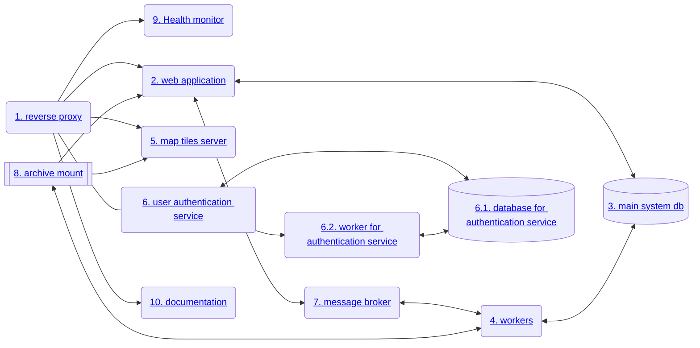

# System administration guide

This document is project deliverable _D13 - Final version of sysadmin-oriented deployment guide_. It contains
information about the deployed SeisLabData system on IPMA's production environment, how to install it and a short
guide for its operational maintenance.


## Production environment overview

The SeisLabData system is operational at IPMA's internal network. Its main entrypoint for users is
by accessing the URL:

<https://seis-lab-data.ipma.pt>

The domain `seis-lab-data.ipma.pt` corresponds to the machine with internal IP `193.137.20.17`. This
machine has the following specifications:

| Property | Value |
| -------- | ----- |
| Type | VMware virtual machine |
|  Processors | 6 cores Intel Xeon @2.30GHz |
|  RAM | 30 GB |
|  Storage | -  380 GB available on the `/home` directory<br><br> -  6 TB available on the `/mnt/seislab_swap` directory |
|  Operating System | Ubuntu 26.04.1 LTS |


### System-relevant files and directories

There are four major sets of files related to the SeisLabData system:

1.  **Configuration and deployment-related files** - The system configuration is mainly composed of files
    located in the `/opt/seis-lab-data` directory, with the following structure:

    ```
    /opt/seis-lab-data/
    ├── secrets/                           # system credentials and other sensitive data
    ├── certs/                             # TLS certificates
    ├── keys/                              # TLS private keys
    ├── compose-deployment.env             # docker compose environment variables
    ├── compose.prod-env.yaml              # docker compose stack
    ├── image_url.env                      # URL of the docker image to be used to deploy the system
    ├── sld-auth-blueprint-prod-env.yaml   # authentication component configuration
    ├── traefik-prod-config.toml           # reverse-proxy component configuration
    └── traefik-tls-config.toml            # reverse-proxy component TLS configuration
    ```

    !!! warning "Files overwritten on each deployment"

        The `compose.prod-env.yaml`, `sld-auth-blueprint-prod-env.yaml`, `traefik-prod-config.toml` and
        `traefik-tls-config.toml` files are copied from the source code repository (from its `docker` directory) on
        each [deployment of a new version](#deploying-new-versions-of-the-system), and `image_url.env` is rewritten.
        Any manual modification to these files is therefore lost on the next deployment. Permanent changes to them
        must be made in the source code repository instead.

2.  **Code artifacts** - The system is deployed as a set of docker images, orchestrated via docker compose. These
    images are stored in the `/var/lib/docker` directory, along with the docker volumes that hold the system's
    databases.

3.  **Auxiliary datasets used by the system** - Auxiliary datasets used by the system, such as the PMTiles files of
    the base map, are stored in a read-write partition of the archive, mounted at the `/mnt/seislab_swap` directory.

4.  **Archived marine datasets that are indexed and shown on the main system catalogue** - The bulk of IPMA's marine
    geoseismic archive data is mounted as a read-only partition at the `/mnt/seislab_data` directory.


### Environment variables

System startup requires the presence of some environment variables. These are defined in two files:

1.  `compose-deployment.env` - This file is edited manually and contains the following variables:

    | Variable                              | Description                                                         |
    |---------------------------------------|---------------------------------------------------------------------|
    | `DEBUG`                               | Debug mode (`true`/`false`) - Should usually be set to `false`. Can be set to `true` if needed, for debug purposes, but note that debug mode may impact the performance of the system. |
    | `LOG_CONFIG_FILE`                     | Path to the logging configuration file. If needed, this file can be edited in order to obtain more verbose logging output, for debug purposes. Note that verbose logging may impact the performance of the system. |
    | `AUTH_AUTHENTIK_BOOTSTRAP_PASSWORD`   | Initial password of the `akadmin` administrator account of the [user authentication service](#6-user-authentication-service-component) component |
    | `AUTH_AUTHENTIK_BOOTSTRAP_TOKEN`      | Initial API token of the [user authentication service](#6-user-authentication-service-component) component, also used by the web application and the workers to query it |
    | `AUTH_AUTHENTIK_BOOTSTRAP_EMAIL`      | Email of the `akadmin` administrator account of the [user authentication service](#6-user-authentication-service-component) component |

    It may also contain the optional variables that set the capacity of the workers, which are described in the
    [workers](#4-workers-component) component section.

2.  `image_url.env` - This file is rewritten each time an automated system deployment is performed. As such, it
    should not be manually edited, except when performing a [manual deployment](#performing-manual-deployments). It
    contains a single variable:

    - `IMAGE_URL` - the docker image to be used in the [web application](#2-web-application-component),
      [workers](#4-workers-component) and [documentation](#10-documentation-component) components

There are many other environment variables that can be used to configure the system. These are indicated
in the relevant section of the docker compose file `compose.prod-env.yaml`. This file is already configured
appropriately for the production environment, so under normal conditions it should not be necessary to modify it.


### External access

External access to the production environment is a highly privileged operation and should be restricted to
system administrators. The only additional access which is required is by the dev team, for the purpose
of initial configuration and subsequent deployment of new versions of the system.

Access is strictly made using SSH with public key authentication, and traffic flows only from a previously
whitelisted machine's IP address.


!!! info "Dev team access to web UI"

    For testing and debugging purposes, members of the dev team requiring access to the system web UI may open an SSH
    connection with a SOCKS proxy:

    ```shell
    ssh seis-lab-data-production -N -D 1080
    ```

    And then use a web browser with proxy support.

    On Linux, for example with Google Chrome:

    ```shell
    google-chrome --proxy-server="socks5://localhost:1080" --user-data-dir="/tmp/chrome-proxy"
    ```

    On macOS, invoke the browser binary through `open`, using a separate profile so the proxy is applied even
    if the browser is already running. For example with Brave:

    ```shell
    open -na "Brave Browser" --args --proxy-server="socks5://localhost:1080" --user-data-dir="/tmp/brave-proxy"
    ```

    With this connection in place, the production environment can be found by browsing to

    <https://seis-lab-data.ipma.pt>


### TLS certificates

The web-facing services of the system use TLS certificates. These are managed externally by IPMA's IT team and
placed manually in the directories:

- `/opt/seis-lab-data/certs/` - certificates
- `/opt/seis-lab-data/keys/` - private keys

The concrete file paths are referenced in the reverse-proxy component configuration file (`traefik-tls-config.toml`),
for example `certs/seis-lab-data.ipma.pt/cert_fullchain.pem` and `keys/seis-lab-data.key` for the main domain. The
reverse proxy watches this file, so renewed certificates placed at the same paths are picked up without restarting
the system.


## Installing the system from scratch

The production environment is already installed. This section describes how to install the system on a new machine,
for example in order to recover from the loss of the production machine.

1.  **Prepare the machine**

    - Install [Docker Engine](https://docs.docker.com/engine/install/ubuntu/), along with its compose plugin;
    - Configure docker to use the `journald` logging driver, by setting `"log-driver": "journald"` in the
      `/etc/docker/daemon.json` file, then restart docker;
    - Mount the archive partitions at `/mnt/seislab_data` (read-only) and `/mnt/seislab_swap` (read-write), and
      place the PMTiles file of the base map at `/mnt/seislab_swap/pmtiles/emodnet-bathymetry-l6.pmtiles`;
    - Ensure the `seis-lab-data.ipma.pt` and `auth.seis-lab-data.ipma.pt` domains resolve to the machine.

2.  **Create the configuration directory** - Create the `/opt/seis-lab-data` directory, along with its `certs`,
    `keys` and `secrets` subdirectories. Place the TLS certificates and private keys in the `certs` and `keys`
    directories, using the file names referenced in the `traefik-tls-config.toml` file.

3.  **Create the secrets** - Create the following files in the `secrets` directory, readable only by the
    administrators. Random values can be generated with `openssl rand -hex 32 | tr -d '\n' > <file>`.

    | File | Contents |
    |------|----------|
    | `db-password.txt` | Password of the `sld` user of the main system database (a random value) |
    | `sld-db-dsn.txt` | Connection string of the main system database, in the form `postgresql+psycopg://sld:<db-password>@db:5432/seis_lab_data` |
    | `auth-db-password.txt` | Password of the database of the user authentication service (a random value) |
    | `auth-secret-key.txt` | Secret key of the user authentication service (a random value) |
    | `auth-client-id.txt` and `auth-client-secret.txt` | Credentials of the OAuth2 client with which the web application connects to the user authentication service (random values, applied to the user authentication service by its blueprint) |
    | `auth-email-username.txt` and `auth-email-password.txt` | Credentials of the SMTP server used by the user authentication service to send emails |
    | `martin-config.yaml` | Configuration of the [map tiles server](#5-map-tiles-server-component) (see below) |

    A minimal `martin-config.yaml` file has the following contents:

    ```yaml
    listen_addresses: '0.0.0.0:3000'
    web_ui: disable
    pmtiles:
      allow_http: false
      sources:
        emodnet-bathymetry: /pmtiles/emodnet-bathymetry-l6.pmtiles
    ```

4.  **Create the environment files** - Create the `compose-deployment.env` file, with the variables described in
    the [environment variables](#environment-variables) section, and the `image_url.env` file, with the docker image
    of the version to install, _e.g._:

    ```shell
    IMAGE_URL=ghcr.io/naturalgis/seis-lab-data/seis-lab-data:v1.0.0
    ```

5.  **Copy the configuration files** - Copy the following files of the source code repository, at the tag of the
    version to install, into `/opt/seis-lab-data`:

    - `docker/compose.prod-env.yaml`
    - `docker/authentik/sld-auth-blueprint-prod-env.yaml`
    - `docker/traefik/traefik-prod-config.toml`
    - `docker/traefik/traefik-tls-config.toml`

6.  **Start the system**, logging in to the `ghcr.io` docker registry first if required:

    ```bash
    cd /opt/seis-lab-data
    docker compose \
        -f compose.prod-env.yaml \
        --env-file compose-deployment.env \
        --env-file image_url.env \
        up -d --wait --wait-timeout 300
    ```

7.  **Initialize the database** - Create the database tables and load the default data (dataset categories,
    workflow stages and asset discovery configurations):

    ```bash
    docker compose \
        -f compose.prod-env.yaml \
        --env-file compose-deployment.env \
        --env-file image_url.env \
        exec webapp uv run seis-lab-data db upgrade

    docker compose \
        -f compose.prod-env.yaml \
        --env-file compose-deployment.env \
        --env-file image_url.env \
        exec webapp uv run seis-lab-data bootstrap all
    ```

8.  **Create the user accounts** - Log in to the administration panel of the user authentication service with the
    `akadmin` account, using the password set in `AUTH_AUTHENTIK_BOOTSTRAP_PASSWORD`, and create the user accounts,
    as described in the [user authentication service](#6-user-authentication-service-component) section.

9.  **Enable the docker cleanup** - Install the systemd units described in the
    [disk space](#preventing-docker-from-occupying-too-much-disk-space) section.

10. **Restore the data** - When recovering from the loss of the production machine, restore the databases from
    their backups, as described in the [database backups](#database-backups) section, then re-run the `db upgrade`
    command of step 7. The `bootstrap all` command is not needed in this case.


## Maintenance operations

The system is orchestrated with [docker compose], which in turn is managed by [systemd], the standard service manager
on Ubuntu.

All docker compose commands shown in this section are to be run from the `/opt/seis-lab-data` directory.

[docker compose]: https://docs.docker.com/compose/
[systemd]: https://systemd.io/


### Checking the status of docker service

Status of the docker services can be monitored by using the standard `systemctl` utility:

```shell
systemctl status docker.service docker.socket
```

The output of the above command should show whether the systemd services for docker are both **active** and **enabled**,
which means that docker is working and that it will restart whenever the machine is rebooted.


### Checking the status of the SeisLabData system

Being orchestrated with docker compose, the status of the running system can be checked by running the
`docker compose ps` command, with the following incantation:

```bash
cd /opt/seis-lab-data
docker compose \
    -f compose.prod-env.yaml \
    --env-file compose-deployment.env \
    --env-file image_url.env \
    ps --all \
    --format "table {{.Service}}\t{{.Status}}"
```

Example output:

```shell
SERVICE              STATUS
auth-db              Up 2 weeks (healthy)
auth-webapp          Up 2 weeks (healthy)
auth-worker          Up 2 weeks (healthy)
db                   Up 2 weeks (healthy)
discovery-worker     Up 2 weeks
docs                 Up 2 weeks
dozzle               Up 2 weeks
interactive-worker   Up 2 weeks
long-tasks-worker    Up 2 weeks
martin-tile-server   Up 2 weeks
message-broker       Up 2 weeks (healthy)
web-gateway          Up 2 weeks
webapp               Up 2 weeks
```

The output shows a listing with the system services and their operational status.

System restart policies can be checked by running the `docker inspect` command for each system-related container:

```shell
docker compose \
    -f compose.prod-env.yaml \
    --env-file compose-deployment.env \
    --env-file image_url.env \
    ps --all --quiet \
    | xargs docker inspect --format '{{.Name}} → restart: {{.HostConfig.RestartPolicy.Name}}'
```

Example output:

```shell
/seis-lab-data-auth-db-1 → restart: unless-stopped
/seis-lab-data-auth-webapp-1 → restart: unless-stopped
/seis-lab-data-auth-worker-1 → restart: unless-stopped
/seis-lab-data-db-1 → restart: unless-stopped
/seis-lab-data-discovery-worker-1 → restart: unless-stopped
/seis-lab-data-docs-1 → restart: unless-stopped
/seis-lab-data-dozzle-1 → restart: unless-stopped
/seis-lab-data-interactive-worker-1 → restart: unless-stopped
/seis-lab-data-long-tasks-worker-1 → restart: unless-stopped
/seis-lab-data-martin-tile-server-1 → restart: unless-stopped
/seis-lab-data-message-broker-1 → restart: unless-stopped
/seis-lab-data-web-gateway-1 → restart: unless-stopped
/seis-lab-data-webapp-1 → restart: unless-stopped
```

The output of the command should show, for each service, the value of `unless-stopped`, which means that docker ensures
the service is running unless manually stopped[^1]. This means that in case of a machine reboot, systemd ensures the
docker engine is booted successfully, and docker ensures the SeisLabData system is also booted.

[^1]: For more information, check the docs on docker compose restart policies: <https://docs.docker.com/reference/compose-file/services/#restart>


### Manually starting and stopping the system

As noted above, the system is configured to remain in continuous operation, including surviving
machine reboots. Nevertheless, if necessary, it can be managed manually.


**Start all services**

```bash
cd /opt/seis-lab-data
docker compose \
    -f compose.prod-env.yaml \
    --env-file compose-deployment.env \
    --env-file image_url.env \
    up -d
```

**Stop all services**

```bash
docker compose \
    -f compose.prod-env.yaml \
    --env-file compose-deployment.env \
    --env-file image_url.env \
    down
```

!!! warning
    The `down` command does not remove persistent volumes (databases). If there is a need to remove
    all persistent data, add the `--volumes` flag. This will delete docker volumes, so be sure to have a suitable
    backup strategy in place before using this flag.


**Restart an individual service**

```shell
docker compose \
    -f compose.prod-env.yaml \
    --env-file compose-deployment.env \
    --env-file image_url.env \
    restart <service-name>
```


### Docker service monitoring

Monitoring of the system logs can be done by either:

1.  Using the standard systemd `journald` component

    The docker engine is configured to use the `journald` logging driver[^5]. As such, logs for the various services
    can be consulted using journald. As an example, logs of the `webapp` docker service from the last hour can be
    inspected with:

    ```shell
    sudo journalctl -b CONTAINER_NAME=seis-lab-data-webapp-1 --since="1 hour ago"
    ```

    !!! tip "How to find container names"

        It is possible to find container names by using the `docker compose ps` command:

        ```shell
        docker compose \
            -f compose.prod-env.yaml \
            --env-file compose-deployment.env \
            --env-file image_url.env \
            ps --all \
            --format "table {{.Name}}"
        ```

2.  Using the `docker compose logs` command

    docker compose comes with a `docker compose logs` command, which can also be used to monitor logs. As an example,
    checking simultaneous logs for all services starting from five minutes ago and continuing to show logs in real-time:

    ```shell
    docker compose \
        -f compose.prod-env.yaml \
        --env-file compose-deployment.env \
        --env-file image_url.env \
        logs --since 5m --follow
    ```

3.  Using the [health monitor](#9-health-monitor-component) component of the system, via a web browser. Access

    <https://seis-lab-data.ipma.pt/monitoring>

    with a valid Authentik account and use the graphical User Interface to consult the logs.


[^5]: More details about the `journald` docker log driver: <https://docs.docker.com/engine/logging/drivers/journald/>


### Database backups

The system keeps its data in two PostgreSQL databases, each stored in a docker volume: the
[main system database](#3-main-system-db-component), which holds the catalog, including the previews and thumbnails
of its records, and the [database of the user authentication service](#61-database-for-authentication-service-component),
which holds the user accounts. The archive datasets themselves are not stored by the system and are not covered here.

Both databases can be backed up with `pg_dump`, while the system is running:

```bash
cd /opt/seis-lab-data

docker compose \
    -f compose.prod-env.yaml \
    --env-file compose-deployment.env \
    --env-file image_url.env \
    exec -T db pg_dump -U sld -d seis_lab_data --format=custom \
    > seis_lab_data-$(date +%Y-%m-%d).dump

docker compose \
    -f compose.prod-env.yaml \
    --env-file compose-deployment.env \
    --env-file image_url.env \
    exec -T auth-db pg_dump -U sld_auth_user -d authentik --format=custom \
    > authentik-$(date +%Y-%m-%d).dump
```

The backup files should be stored outside of the production machine, along with a copy of the `secrets` directory
and of the `compose-deployment.env` file, which are needed to install the system again.

To restore a backup, stop the services that use the database, restore it with `pg_restore` and start the system
again. For example, for the main system database:

```bash
docker compose \
    -f compose.prod-env.yaml \
    --env-file compose-deployment.env \
    --env-file image_url.env \
    stop webapp interactive-worker long-tasks-worker discovery-worker

docker compose \
    -f compose.prod-env.yaml \
    --env-file compose-deployment.env \
    --env-file image_url.env \
    exec -T db pg_restore -U sld -d seis_lab_data --clean --if-exists \
    < seis_lab_data-<date>.dump

docker compose \
    -f compose.prod-env.yaml \
    --env-file compose-deployment.env \
    --env-file image_url.env \
    up -d
```

The database of the user authentication service is restored likewise, stopping the `auth-webapp` and `auth-worker`
services and using the `auth-db` service, the `sld_auth_user` user and the `authentik` database.


### Preventing docker from occupying too much disk space

There are two systemd units enabled in the system that are responsible for cleaning up unused docker resources.
These units are:

- `/etc/systemd/system/clean-docker-images.service` - removes the unused docker images, the build cache and the
  stopped containers which are older than 72 hours
- `/etc/systemd/system/clean-docker-images.timer` - runs the `clean-docker-images.service`

Docker cleaning runs weekly, on Sundays at around 01h. Since each deployment pulls a new docker image, this keeps the
images of previous versions from accumulating.

!!! tip

    The aforementioned systemd unit files are in the source code repository, under `deployments/systemd-units`. These
    were simply copied over to the `/etc/systemd/system` directory on the production machine and then enabled with:

    ```shell
    sudo systemctl enable --now clean-docker-images.timer
    ```

    The service runs as the `naturalgis` user, as set by the `User` option of `clean-docker-images.service`. When
    installing it on another machine, set this option to a user that belongs to the `docker` group.


## Deploying new versions of the system

New versions of the system are deployed using a semi-automated workflow. When a new version of the system is deemed
production-ready, a member of the dev team manually generates a git tag and pushes it to the source code repository.

Example git commands:

```shell
# generate git tag named with the expected pattern of vX.Y.Z
git tag --annotate --message='Tagged version 1.0.2' v1.0.2

# push the newly generated tag to the central remote, here named upstream
git push upstream v1.0.2
```

This then sets off a sequence of automated procedures that culminates with the new version being deployed.
The full deployment sequence is:

1.  Dev team member creates a git tag with a naming pattern of `vX.Y.Z` and pushes this tag to the central
    GitHub-hosted source code repository

    !!! warning
        Any tag pushed to the repository triggers a deployment to the production environment, so tags must only be
        pushed for versions which are ready for production. Commits pushed to the `main` branch are deployed to the
        test environment instead.

2.  When the tag arrives at the repository, the workflow in `.github/workflows/ci.yaml` runs, performing the
    following steps:

    1.  Perform static analysis of the code to check for errors;

    2.  Check that the code is formatted in accordance with the standard styling;

    3.  Build a docker image with the code - this is the artifact that will ultimately get deployed;

    4.  Run various tests using the built docker image - these include unit, integration and end-to-end tests;

    5.  Publish the built docker image in the repository's docker registry. This registry is available at:

        <https://github.com/NaturalGIS/seis-lab-data/pkgs/container/seis-lab-data%2Fseis-lab-data>

    6.  Render the report of the test results, which is stored as an artifact of the workflow run;

    7.  Call the `.github/workflows/deployment-initiator.yml` workflow, which waits for the image to be published and
        creates a GitHub deployment for the `ipma-production` environment. GitHub then notifies the dev team's
        deployment machine, via a webhook, that a new version is ready to be deployed

3.  The deployment machine is running the [woodpecker CI] tool for managing deployments. This tool receives the
    webhook notification and uses the instructions present in the `.woodpecker/deployment.yaml` file to handle the
    deployment.

    !!! note "GitHub repository cannot access IPMA production environment"
        Note that the GitHub-hosted source code repository is not allowed to access IPMA's production environment and
        does not store any access credentials for it - access is always done via the deployment machine, which
        is fully controlled and secured by the dev team.

        The dev machine's deployment tool is accessible (to authorized users) at:

        <https://ci.seis-lab-data.naturalgis.pt>


4.  The deployment machine now kicks-off the following workflow:

    1.  Extract the URL of the new docker image from the GitHub deployment
    2.  Copy the `compose.prod-env.yaml`, `sld-auth-blueprint-prod-env.yaml`, `traefik-prod-config.toml` and
        `traefik-tls-config.toml` configuration files to the production environment, via SSH
    3.  Connect to the production environment via SSH and pull the new docker image of the system from the docker
        registry
    4.  Write the URL of the new docker image to the `image_url.env` file
    5.  Restart the docker compose stack, waiting for its services to be up and healthy
    6.  Apply the database migrations of the new version, if any
    7.  Send a notification to the dev team when the deployment is done, stating whether it succeeded or failed


### Performing manual deployments

While the preferred deployment workflow is the semi-automated procedure described above, it is also possible
to perform manual deployments, for example when the deployment machine is not available:

1.  Ensure the docker image of the new version has been published to the docker registry - the CI workflow publishes
    it when the version's git tag is pushed to the repository (see the example git commands posted in the beginning
    of this section);

2.  Copy the configuration files listed in step 5 of the [installation](#installing-the-system-from-scratch) section
    from the source code repository, at the tag of the new version, into `/opt/seis-lab-data`;

3.  Edit the `/opt/seis-lab-data/image_url.env` file and update `IMAGE_URL` to the new image version;

4.  Perform the deployment:

    ```bash
    cd /opt/seis-lab-data
    docker compose \
        -f compose.prod-env.yaml \
        --env-file compose-deployment.env \
        --env-file image_url.env \
        up -d --remove-orphans --wait --wait-timeout 300
    ```

5.  Apply the database migrations of the new version. This command does nothing if there are none:

    ```bash
    docker compose \
        -f compose.prod-env.yaml \
        --env-file compose-deployment.env \
        --env-file image_url.env \
        exec webapp uv run seis-lab-data db upgrade
    ```


### Version-specific upgrade steps

Some versions require manual steps in addition to the deployment itself. These steps apply to both the production
and the test environments.


#### Upgrading from version 0.6.0

1.  Before deploying, update the Martin configuration file (`/opt/seis-lab-data/secrets/martin-config.yaml` in
    production). Martin 1.x publishes a symlinked PMTiles file only under the name of the file it links to, so the
    `emodnet-bathymetry` source must be named explicitly, and Martin requires an explicit `allow_http` setting:

    ```yaml
    pmtiles:
      allow_http: false
      sources:
        emodnet-bathymetry: /pmtiles/emodnet-bathymetry-l6.pmtiles
    ```

    The path must point to the actual PMTiles file of the environment, not to a symlink.

2.  After deploying, check that the base map is shown on the map of the projects page.

3.  After deploying, generate the thumbnails of the projects and survey missions that already have a spatial
    extent, as thumbnails are only generated when an extent is set or changed:

    ```bash
    docker compose \
        -f compose.prod-env.yaml \
        --env-file compose-deployment.env \
        --env-file image_url.env \
        exec webapp uv run seis-lab-data generate-thumbnails
    ```

[woodpecker CI]: https://woodpecker-ci.org/


## System components

This section contains a brief description of the main components of the SeisLabData system.

<span class="no-pdf">

</span>

#### 1. `reverse proxy` component

This component is a [Traefik](https://doc.traefik.io/traefik/) instance. It receives HTTP requests
and routes them to the appropriate service, according to the rules in the table below. Requests made over plain HTTP
are redirected to HTTPS.

| Routing rule                                          | Destination service             |
|-------------------------------------------------------|---------------------------------|
| host: `seis-lab-data.ipma.pt`                         | `web application`               |
| host: `auth.seis-lab-data.ipma.pt`                    | `user authentication service`   |
| host: `seis-lab-data.ipma.pt`<br> path: `/tiles`      | `map tiles server`              |
| host: `seis-lab-data.ipma.pt`<br> path: `/monitoring` | `health monitor`                |
| host: `seis-lab-data.ipma.pt`<br> path: `/docs`       | `documentation`                 |


##### Relevant configuration files

- `traefik-prod-config.toml` - Traefik static configuration
- `traefik-tls-config.toml` - file indicating the location of TLS certificates
- `compose.prod-env.yaml` - Traefik dynamic configurations are defined as Docker labels in this file


#### 2. `web application` component

This is the main component of the system. It consists of a web application that serves the graphical
interface and a read-only [STAC](https://stacspec.org/) API, under the `/stac` path, that allows other systems to
query the catalogue. It also serves downloads of the datasets in the archive, enforcing the same access rules as the
catalogue records they belong to.

It runs 8 web server processes, as set by the `SEIS_LAB_DATA__NUM_WEB_WORKER_PROCESSES` setting (default 8).


##### Relevant configuration files

- `compose.prod-env.yaml` - `webapp` service; configuration is done via docker compose's support for environment
  variables. These are set in the `environment` section of the `webapp` service
- `secrets/sld-db-dsn.txt` - main database access credentials
- `secrets/auth-client-id.txt` and `secrets/auth-client-secret.txt` - authentication service access credentials used
  by the webapp when needing to contact the authentication service


#### 3. `main system db` component

[PostgreSQL](https://www.postgresql.org/) instance with the PostGIS extension. Stores the system's
catalog records, along with the previews and thumbnails generated for them. Its data is stored in the `db` docker
volume.


##### Relevant configuration files

- `compose.prod-env.yaml` - `db` service
- `secrets/db-password.txt` - Contains the password of the database user


!!! note "Direct access to the database"

    The `compose.prod-env.yaml` file does not publish any ports from the database docker service to the local host.
    This means the database can only be accessed from the machine where the system is installed and that access must
    be done by connecting to the `db` service directly.

    Example command:

    ```bash
    docker compose \
        -f compose.prod-env.yaml \
        --env-file compose-deployment.env \
        --env-file image_url.env \
        exec db psql -U sld -d seis_lab_data
    ```


#### 4. `workers` component

[Dramatiq](https://dramatiq.io/) application that executes background tasks, like the creation
and processing of records in the system. Communicates with the web application mostly via a publish/subscribe
pattern[^2] through the `message broker` component.

It runs as three services, so that tasks which may take long never delay the interactive ones, and archive
discovery never delays the other long tasks:

- `interactive-worker` - runs the quick, user-facing tasks, such as creating, updating, deleting, validating and
  publishing items (`default` queue)
- `long-tasks-worker` - runs previews, thumbnails and GeoNode exports (`previews`, `thumbnails` and `exports`
  queues)
- `discovery-worker` - runs archive discoveries (`discovery` queue)

The number of processes and threads of each service caps how many of its tasks run at the same time. They can be
set in `compose-deployment.env`:

| service | processes (default) | threads per process (default) |
|---|---|---|
| `interactive-worker` | `INTERACTIVE_WORKER_PROCESSES` (2) | `INTERACTIVE_WORKER_THREADS` (8) |
| `long-tasks-worker` | `LONG_TASKS_WORKER_PROCESSES` (2) | `LONG_TASKS_WORKER_THREADS` (4) |
| `discovery-worker` | `DISCOVERY_WORKER_PROCESSES` (3) | 1 |

Each `discovery-worker` process discovers one mission at a time, so the number of processes is the number of
missions that can be discovered in parallel.

Each archive discovery reads `DISCOVERY_EXTRACTION_CONCURRENCY` files at the same time (default 4), each one in a
worker process of its own, which can also be set in `compose-deployment.env`. Reading files from the archive is
partly waiting on the storage and partly CPU work (e.g. walking the datagrams of a KMALL file), so a higher value
speeds up discovery, at the cost of more load on the storage and on the CPU. Discovering several missions at once
runs up to `DISCOVERY_WORKER_PROCESSES` × `DISCOVERY_EXTRACTION_CONCURRENCY` of these worker processes; on a
machine that also runs the database and the other services, keep that well below the number of CPU cores.

A discovery run stops after `DISCOVERY_TIME_LIMIT_HOURS` hours (default 24, at most 168), which can also be set in
`compose-deployment.env`. The records it created until then are kept, and running the discovery again resumes it,
as the files that already have records are skipped.

Discovery writes its records in batches of up to 500 files, each one written at most 5 seconds after it began. These
rarely need changing; if they do, set `SEIS_LAB_DATA__DISCOVERY_BATCH_SIZE` and
`SEIS_LAB_DATA__DISCOVERY_BATCH_MAX_SECONDS` in the environment of the `discovery-worker` service in
`compose.prod-env.yaml`, in the source code repository, as this file is overwritten on each deployment. The previews
of the records are requested as each batch is written, so they are generated by the `long-tasks-worker` while
discovery is still running. At the end of each run, and with each progress update, the worker logs where the run's
time went (walking the archive, extracting metadata and database work) and its slowest extractions, which helps in
choosing these values.

##### Database connections

Each process of the `webapp` and of the workers keeps up to `SEIS_LAB_DATA__DB_POOL_SIZE` connections to the
database open (default 5), and may open up to `SEIS_LAB_DATA__DB_MAX_OVERFLOW` more when busy (default 5). A task
or request that finds no free connection waits up to `SEIS_LAB_DATA__DB_POOL_TIMEOUT` seconds (default 30), then
fails. The database accepts at most 200 connections, as set by the `command` of the `db` service in
`compose.prod-env.yaml`. When changing the number of processes, check that the total stays below that limit:

```
(webapp processes + all worker processes) × (DB_POOL_SIZE + DB_MAX_OVERFLOW) + margin
```

With the defaults: (8 + 2 + 2 + 3) × (5 + 5) = 150, leaving 50 connections for administration.

##### Exporting records to GeoNode

The workers can export survey-related records to a GeoNode instance. This feature is disabled unless the
`SEIS_LAB_DATA__TARGET_GEONODE__URL` setting is defined, which is currently not the case in the production
environment. Enabling it requires adding the following settings to the environment of the `webapp` and worker services of
`compose.prod-env.yaml`, in the source code repository:

- `SEIS_LAB_DATA__TARGET_GEONODE__URL` - URL of the GeoNode instance
- `SEIS_LAB_DATA__TARGET_GEONODE__USERNAME` and `SEIS_LAB_DATA__TARGET_GEONODE__PASSWORD` - credentials of a GeoNode
  service account, used only by SeisLabData, which becomes the owner of the exported resources
- `SEIS_LAB_DATA__TARGET_GEONODE__CLIENT_ID` and `SEIS_LAB_DATA__TARGET_GEONODE__CLIENT_SECRET` - credentials of a
  GeoNode OAuth2 application, which must be _confidential_ and use the _resource owner password-based_ grant type
- `SEIS_LAB_DATA__PUBLIC_URL` - must also be set for the workers, as exported GeoNode resources link back to their
  record's page

[^2]: General overview of the publish/subscribe pattern: <https://en.wikipedia.org/wiki/Publish%E2%80%93subscribe_pattern>


#### 5. `map tiles server` component

[Martin](https://martin.maplibre.org/) instance that serves the base map tiles from PMTiles files, which are read from
the `/mnt/seislab_swap/pmtiles` directory. Accessible under the `/tiles` path of the main domain. The workers also use
it to draw the base map of the thumbnails.


##### Relevant configuration files

- The Martin configuration file is maintained as a Docker secret at
  `/opt/seis-lab-data/secrets/martin-config.yaml`


#### 6. `user authentication service` component

[Authentik](https://goauthentik.io/) instance that manages user authentication and authorization
via OpenID Connect[^4]. Accessible at `auth.seis-lab-data.ipma.pt`. The system defines a single user group:

[^4]: Overview OpenID connect: <https://openid.net/developers/how-connect-works/>

`seis-lab-data-catalog-editors` - users with permission to manage the catalog contents, including its
  settings (dataset categories, workflow stages and asset discovery configurations)

Authentik superusers, such as the `akadmin` account created when the system is installed, also have these
permissions. Users that are neither superusers nor members of this group are only able to view the catalog,
including its unpublished items, while anonymous visitors are only able to view the published items.

User management (account creation, group assignment, password reset) is done through the Authentik
administration panel, accessible at `auth.seis-lab-data.ipma.pt/if/admin/`.

Users are not able to self-register on the system. New user accounts must be created by a system
administrator, as follows:

1. In the Authentik administration panel, navigate to _Directory_ -> _Users_ and click _Create_
2. Fill in the user's username, name and email and save
3. Open the newly created user and use the _Set password_ button to define an initial password,
   which must then be communicated to the user
4. If the user should be able to edit the catalog, add them to the `seis-lab-data-catalog-editors` group in
   the user's _Groups_ tab


##### Relevant configuration files

- `sld-auth-blueprint-prod-env.yaml` - Authentik initial configuration blueprint, which creates the
  `seis-lab-data` application, the `seis-lab-data-catalog-editors` group and the protection of the health monitor
- Relevant secrets: `auth-secret-key.txt`, `auth-client-id.txt`, `auth-client-secret.txt`,
  `auth-db-password.txt`, `auth-email-username.txt`, `auth-email-password.txt`


#### 6.1. `database for authentication service` component

PostgreSQL instance dedicated to Authentik. Not shared with the main system database. Its data is stored in the
`authentik_db` docker volume.


#### 6.2. `worker for authentication service` component

Authentik worker component, responsible for background tasks such as sending emails and applying
blueprints.


#### 7. `message broker` component

[Redis](https://redis.io/) instance used both as a message queue and message broker between the `web application` and the
`workers` components. It is also used by the user authentication service.


##### Relevant configuration files

There is no relevant configuration for this component.


#### 8. `archive mount` component

This component consists of the volumes that mount the archive filesystem on the node containing
the installation.

| Mount point on the server | Mount point in the containers | Purpose |
|---------------------------|-------------------------------|---------|
| `/mnt/seislab_data`       | `/data/archive`               | Allows the system to access datasets in IPMA's archive — the system only reads from this mount. |
| `/mnt/seislab_swap`       | `/data/sld-data`              | Mount with write access. This space is used to store auxiliary datasets, such as the PMTiles files of the base map. |

These volumes are subsequently mounted inside the relevant docker containers so that they can be
used by system services:

- [2. `web application` component](#2-web-application-component)
- [4. `workers` component](#4-workers-component)
- [5. `map tiles server` component](#5-map-tiles-server-component) - only the `/mnt/seislab_swap/pmtiles` directory


#### 9. `health monitor` component

[Dozzle](https://dozzle.dev/) instance that allows viewing the logs of all services in real time
through a web interface. Accessible at `seis-lab-data.ipma.pt/monitoring`. Access is protected by
the authentication service.


#### 10. `documentation` component

Serves this documentation, including the PDF versions of its guides. Accessible at `seis-lab-data.ipma.pt/docs`.
The documentation is built into the docker image of the system, so it is updated with each deployment.
