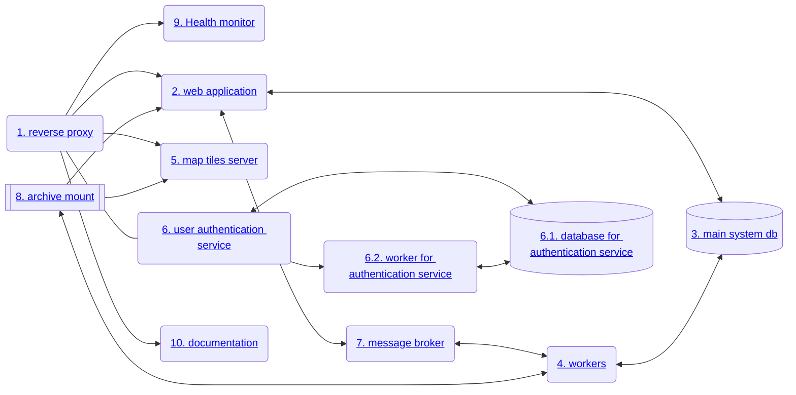

# Guia de administração do sistema

<span class="no-pdf">
    [ :material-file-pdf-box: Descarregar versão PDF](assets/documents/seis-lab-data-administration-guide.pdf){ .md-button .no-pdf }
</span>

Este documento é o entregável de projeto _D13 - Versão final do guia de instalação orientado ao administrador de
sistemas_. Contém informação sobre o sistema SeisLabData instalado no ambiente de produção do IPMA, sobre como
instalá-lo e um breve guia para a sua manutenção operacional.


## Ambiente de produção

O sistema SeisLabData está disponível dentro da rede interna do IPMA. O seu ponto de
entrada principal para os utilizadores é através do URL:

<https://seis-lab-data.ipma.pt>

O domínio `seis-lab-data.ipma.pt` corresponde à máquina com IP interno `193.137.20.17`. Esta
máquina tem as seguintes especificações:

| Propriedade | Valor |
| -------- | ----- |
| Tipo | Máquina virtual VMware |
| Processadores | 6 núcleos Intel Xeon @2.30GHz |
| RAM | 30 GB |
| Armazenamento | - 380 GB disponíveis no diretório `/home`<br><br> - 6 TB disponíveis no diretório `/mnt/seislab_swap` |
| Sistema Operativo | Ubuntu 26.04.1 LTS |


### Ficheiros e diretórios relevantes do sistema

Existem quatro conjuntos principais de ficheiros relacionados com o sistema SeisLabData:

1.  **Ficheiros de configuração e instalação** - A configuração do sistema é principalmente composta por ficheiros
    localizados no diretório `/opt/seis-lab-data`, com a seguinte estrutura:

    ```
    /opt/seis-lab-data/
    ├── secrets/                           # credenciais e outros dados secretos do sistema
    ├── certs/                             # Certificados TLS
    ├── keys/                              # Chaves privadas TLS
    ├── compose-deployment.env             # Variáveis de ambiente do docker compose
    ├── compose.prod-env.yaml              # Stack docker compose
    ├── image_url.env                      # URL da imagem docker a utilizar para instalar o sistema
    ├── sld-auth-blueprint-prod-env.yaml   # Configuração do serviço de autenticação
    ├── traefik-prod-config.toml           # Configuração da componente reverse-proxy
    └── traefik-tls-config.toml            # Configuração TLS da componente reverse-proxy
    ```

    !!! warning "Ficheiros substituídos em cada implementação"

        Os ficheiros `compose.prod-env.yaml`, `sld-auth-blueprint-prod-env.yaml`, `traefik-prod-config.toml` e
        `traefik-tls-config.toml` são copiados do repositório de código-fonte (do seu diretório `docker`) em cada
        [implementação de uma nova versão](#implementacao-de-novas-versoes-do-sistema), e o ficheiro `image_url.env`
        é reescrito. Qualquer modificação manual a estes ficheiros perde-se, por isso, na implementação seguinte. As
        alterações permanentes a estes ficheiros devem antes ser feitas no repositório de código-fonte.

2.  **Artefactos de código** - O sistema é instalado como um conjunto de imagens docker, orquestradas via docker
    compose. Estas imagens estão armazenadas no diretório `/var/lib/docker`, juntamente com os volumes docker que
    contêm as bases de dados do sistema.

3.  **Conjuntos de dados auxiliares utilizados pelo sistema** - Os conjuntos de dados auxiliares utilizados pelo
    sistema, como os ficheiros PMTiles do mapa base, estão armazenados numa partição de leitura-escrita do arquivo,
    montada no diretório `/mnt/seislab_swap`.

4.  **Conjuntos de dados marinhos arquivados que são indexados e apresentados no catálogo principal do sistema** -
    A maior parte dos dados do arquivo marinho geossísmico do IPMA está montada como uma partição só de leitura no
    diretório `/mnt/seislab_data`.


### Variáveis de ambiente

O arranque do sistema requer a presença de algumas variáveis de ambiente. Estas estão definidas em dois ficheiros:

1.  `compose-deployment.env` - Este ficheiro é editado manualmente e contém as seguintes variáveis:

    | Variável                              | Descrição                                                           |
    |---------------------------------------|---------------------------------------------------------------------|
    | `DEBUG`                               | Modo de depuração (`true`/`false`) - Deve normalmente estar definido como `false`. Pode ser definido como `true` se necessário, para fins de depuração, mas note-se que o modo de depuração pode afetar o desempenho do sistema. |
    | `LOG_CONFIG_FILE`                     | Caminho para o ficheiro de configuração de _logs_. Se necessário, este ficheiro pode ser editado de modo a obter uma saída de _logs_ mais detalhada, para fins de depuração. Note-se que _logging_ detalhado pode afetar o desempenho do sistema. |
    | `AUTH_AUTHENTIK_BOOTSTRAP_PASSWORD`   | Palavra-passe inicial da conta de administrador `akadmin` da componente [user authentication service](#6-componente-user-authentication-service) |
    | `AUTH_AUTHENTIK_BOOTSTRAP_TOKEN`      | _Token_ inicial da API da componente [user authentication service](#6-componente-user-authentication-service), também utilizado pela aplicação web e pelos _workers_ para a consultar |
    | `AUTH_AUTHENTIK_BOOTSTRAP_EMAIL`      | Email da conta de administrador `akadmin` da componente [user authentication service](#6-componente-user-authentication-service) |

    Pode conter também as variáveis opcionais que definem a capacidade dos _workers_, descritas na secção da
    componente [workers](#4-componente-workers).

2.  `image_url.env` - Este ficheiro é reescrito de cada vez que é realizada uma instalação automatizada do
    sistema. Como tal, não deve ser editado manualmente, exceto ao realizar uma
    [implementação manual](#realizar-implementacoes-manuais). Contém uma única variável:

    - `IMAGE_URL` - a imagem docker a utilizar nas componentes [web application](#2-componente-web-application),
      [workers](#4-componente-workers) e [documentation](#10-componente-documentation)

Existem muitas outras variáveis de ambiente que podem ser usadas para configurar o sistema. Estas são
indicadas na secção relevante do ficheiro docker compose `compose.prod-env.yaml`. Este ficheiro está
configurado de forma apropriada para o ambiente de produção, pelo que em condições normais não será
necessário modificá-lo.


### Acesso externo

O acesso externo ao ambiente de produção é uma operação altamente privilegiada e deve ser restrito
aos administradores do sistema. O único acesso adicional necessário é o da equipa de desenvolvimento,
para fins de configuração inicial e posterior instalação de novas versões do sistema.

O acesso é feito exclusivamente por SSH com autenticação por chave pública, e o tráfego flui apenas
a partir do endereço IP de uma máquina previamente autorizada.


!!! info "Acesso da equipa de desenvolvimento à interface web"

    Para fins de teste e depuração, os membros da equipa de desenvolvimento que necessitem de aceder
    à interface web do sistema podem abrir uma ligação SSH com proxy SOCKS:

    ```shell
    ssh seis-lab-data-production -N -D 1080
    ```

    E depois usar um navegador web com suporte de proxy.

    Em Linux, por exemplo com o Google Chrome:

    ```shell
    google-chrome --proxy-server="socks5://localhost:1080" --user-data-dir="/tmp/chrome-proxy"
    ```

    Em macOS, invocar o binário do navegador através do `open`, usando um perfil separado para que o proxy
    seja aplicado mesmo que o navegador já esteja aberto. Por exemplo, com o Brave:

    ```shell
    open -na "Brave Browser" --args --proxy-server="socks5://localhost:1080" --user-data-dir="/tmp/brave-proxy"
    ```

    Com esta ligação ativa, o ambiente de produção pode ser acedido navegando para

    <https://seis-lab-data.ipma.pt>


### Certificados TLS

Os serviços web do sistema utilizam certificados TLS. Estes são geridos externamente pela equipa de TI
do IPMA e colocados manualmente nos diretórios:

- `/opt/seis-lab-data/certs/` - certificados
- `/opt/seis-lab-data/keys/` - chaves privadas

Os caminhos concretos dos ficheiros estão referenciados no ficheiro de configuração da componente reverse-proxy
(`traefik-tls-config.toml`), por exemplo `certs/seis-lab-data.ipma.pt/cert_fullchain.pem` e `keys/seis-lab-data.key`
para o domínio principal. O reverse-proxy monitoriza este ficheiro, pelo que os certificados renovados colocados nos
mesmos caminhos são carregados sem necessidade de reiniciar o sistema.


## Instalação do sistema de raiz

O ambiente de produção já se encontra instalado. Esta secção descreve como instalar o sistema numa nova máquina, por
exemplo para recuperar da perda da máquina de produção.

1.  **Preparar a máquina**

    - Instalar o [Docker Engine](https://docs.docker.com/engine/install/ubuntu/), juntamente com o seu _plugin_
      compose;
    - Configurar o docker para utilizar o _driver_ de _logging_ `journald`, definindo `"log-driver": "journald"` no
      ficheiro `/etc/docker/daemon.json`, e reiniciar o docker;
    - Montar as partições do arquivo em `/mnt/seislab_data` (só de leitura) e `/mnt/seislab_swap` (leitura-escrita),
      e colocar o ficheiro PMTiles do mapa base em `/mnt/seislab_swap/pmtiles/emodnet-bathymetry-l6.pmtiles`;
    - Garantir que os domínios `seis-lab-data.ipma.pt` e `auth.seis-lab-data.ipma.pt` apontam para a máquina.

2.  **Criar o diretório de configuração** - Criar o diretório `/opt/seis-lab-data`, juntamente com os seus
    subdiretórios `certs`, `keys` e `secrets`. Colocar os certificados TLS e as chaves privadas nos diretórios
    `certs` e `keys`, com os nomes de ficheiro referenciados no ficheiro `traefik-tls-config.toml`.

3.  **Criar os segredos** - Criar os seguintes ficheiros no diretório `secrets`, legíveis apenas pelos
    administradores. Podem ser gerados valores aleatórios com `openssl rand -hex 32 | tr -d '\n' > <ficheiro>`.

    | Ficheiro | Conteúdo |
    |----------|----------|
    | `db-password.txt` | Palavra-passe do utilizador `sld` da base de dados principal do sistema (um valor aleatório) |
    | `sld-db-dsn.txt` | _String_ de ligação à base de dados principal do sistema, na forma `postgresql+psycopg://sld:<db-password>@db:5432/seis_lab_data` |
    | `auth-db-password.txt` | Palavra-passe da base de dados do serviço de autenticação (um valor aleatório) |
    | `auth-secret-key.txt` | Chave secreta do serviço de autenticação (um valor aleatório) |
    | `auth-client-id.txt` e `auth-client-secret.txt` | Credenciais do cliente OAuth2 com o qual a aplicação web se liga ao serviço de autenticação (valores aleatórios, aplicados ao serviço de autenticação pelo seu _blueprint_) |
    | `auth-email-username.txt` e `auth-email-password.txt` | Credenciais do servidor SMTP utilizado pelo serviço de autenticação para enviar emails |
    | `martin-config.yaml` | Configuração do [map tiles server](#5-componente-map-tiles-server) (ver abaixo) |

    Um ficheiro `martin-config.yaml` mínimo tem o seguinte conteúdo:

    ```yaml
    listen_addresses: '0.0.0.0:3000'
    web_ui: disable
    pmtiles:
      allow_http: false
      sources:
        emodnet-bathymetry: /pmtiles/emodnet-bathymetry-l6.pmtiles
    ```

4.  **Criar os ficheiros de ambiente** - Criar o ficheiro `compose-deployment.env`, com as variáveis descritas na
    secção [variáveis de ambiente](#variaveis-de-ambiente), e o ficheiro `image_url.env`, com a imagem docker da
    versão a instalar, _p. ex._:

    ```shell
    IMAGE_URL=ghcr.io/naturalgis/seis-lab-data/seis-lab-data:v1.0.0
    ```

5.  **Copiar os ficheiros de configuração** - Copiar os seguintes ficheiros do repositório de código-fonte, na _tag_
    da versão a instalar, para `/opt/seis-lab-data`:

    - `docker/compose.prod-env.yaml`
    - `docker/authentik/sld-auth-blueprint-prod-env.yaml`
    - `docker/traefik/traefik-prod-config.toml`
    - `docker/traefik/traefik-tls-config.toml`

6.  **Iniciar o sistema**, autenticando-se primeiro no registo docker `ghcr.io`, se necessário:

    ```bash
    cd /opt/seis-lab-data
    docker compose \
        -f compose.prod-env.yaml \
        --env-file compose-deployment.env \
        --env-file image_url.env \
        up -d --wait --wait-timeout 300
    ```

7.  **Inicializar a base de dados** - Criar as tabelas da base de dados e carregar os dados predefinidos (categorias
    de conjuntos de dados, etapas de _workflow_ e configurações de descoberta de recursos):

    ```bash
    docker compose \
        -f compose.prod-env.yaml \
        --env-file compose-deployment.env \
        --env-file image_url.env \
        exec webapp uv run seis-lab-data db upgrade

    docker compose \
        -f compose.prod-env.yaml \
        --env-file compose-deployment.env \
        --env-file image_url.env \
        exec webapp uv run seis-lab-data bootstrap all
    ```

8.  **Criar as contas de utilizador** - Entrar no painel de administração do serviço de autenticação com a conta
    `akadmin`, usando a palavra-passe definida em `AUTH_AUTHENTIK_BOOTSTRAP_PASSWORD`, e criar as contas de
    utilizador, conforme descrito na secção [user authentication service](#6-componente-user-authentication-service).

9.  **Ativar a limpeza do docker** - Instalar as unidades systemd descritas na secção sobre o
    [espaço em disco](#evitar-que-o-docker-ocupe-demasiado-espaco-em-disco).

10. **Restaurar os dados** - Ao recuperar da perda da máquina de produção, restaurar as bases de dados a partir das
    suas cópias de segurança, conforme descrito na secção [cópias de segurança](#copias-de-seguranca-das-bases-de-dados),
    e voltar a executar o comando `db upgrade` do passo 7. Neste caso, o comando `bootstrap all` não é necessário.


## Operações de manutenção

O sistema é orquestrado com o [docker compose], que por sua vez é gerido pelo [systemd], o gestor de
serviços padrão no Ubuntu.

Todos os comandos docker compose apresentados nesta secção devem ser executados a partir do diretório
`/opt/seis-lab-data`.

[docker compose]: https://docs.docker.com/compose/
[systemd]: https://systemd.io/


### Verificar o estado do serviço docker

O estado dos serviços docker pode ser monitorizado utilizando o utilitário padrão `systemctl`:

```shell
systemctl status docker.service docker.socket
```

O resultado do comando acima deve indicar se os serviços systemd do docker estão **ativos** e **ativados**,
o que significa que o docker está a funcionar e que será reiniciado sempre que a máquina for reiniciada.


### Verificar o estado do sistema SeisLabData

Sendo orquestrado com docker compose, o estado do sistema em execução pode ser verificado com o
comando `docker compose ps`:

```bash
cd /opt/seis-lab-data
docker compose \
    -f compose.prod-env.yaml \
    --env-file compose-deployment.env \
    --env-file image_url.env \
    ps --all \
    --format "table {{.Service}}\t{{.Status}}"
```

Exemplo de resultado:

```shell
SERVICE              STATUS
auth-db              Up 2 weeks (healthy)
auth-webapp          Up 2 weeks (healthy)
auth-worker          Up 2 weeks (healthy)
db                   Up 2 weeks (healthy)
discovery-worker     Up 2 weeks
docs                 Up 2 weeks
dozzle               Up 2 weeks
interactive-worker   Up 2 weeks
long-tasks-worker    Up 2 weeks
martin-tile-server   Up 2 weeks
message-broker       Up 2 weeks (healthy)
web-gateway          Up 2 weeks
webapp               Up 2 weeks
```

O resultado apresenta uma listagem dos serviços do sistema e o seu estado operacional.

As políticas de reinício podem ser verificadas com o comando `docker inspect` para cada contentor
do sistema:

```shell
docker compose \
    -f compose.prod-env.yaml \
    --env-file compose-deployment.env \
    --env-file image_url.env \
    ps --all --quiet \
    | xargs docker inspect --format '{{.Name}} → restart: {{.HostConfig.RestartPolicy.Name}}'
```

Exemplo de resultado:

```shell
/seis-lab-data-auth-db-1 → restart: unless-stopped
/seis-lab-data-auth-webapp-1 → restart: unless-stopped
/seis-lab-data-auth-worker-1 → restart: unless-stopped
/seis-lab-data-db-1 → restart: unless-stopped
/seis-lab-data-discovery-worker-1 → restart: unless-stopped
/seis-lab-data-docs-1 → restart: unless-stopped
/seis-lab-data-dozzle-1 → restart: unless-stopped
/seis-lab-data-interactive-worker-1 → restart: unless-stopped
/seis-lab-data-long-tasks-worker-1 → restart: unless-stopped
/seis-lab-data-martin-tile-server-1 → restart: unless-stopped
/seis-lab-data-message-broker-1 → restart: unless-stopped
/seis-lab-data-web-gateway-1 → restart: unless-stopped
/seis-lab-data-webapp-1 → restart: unless-stopped
```

O resultado do comando deve mostrar, para cada serviço, o valor `unless-stopped`, o que significa que
o docker garante que o serviço está em execução salvo se for parado manualmente[^1]. Isto significa que
em caso de reinício da máquina, o systemd garante que o motor docker arranca corretamente, e o docker
garante que o sistema SeisLabData também arranca.

[^1]: Para mais informações, consultar a documentação sobre políticas de reinício do docker compose: <https://docs.docker.com/reference/compose-file/services/#restart>


### Iniciar e parar o sistema manualmente

Conforme indicado anteriormente, o sistema está configurado para se manter em operação contínua,
inclusive sobrevivendo a _reboots_ da máquina. Ainda assim, se necessário, é possível geri-lo
manualmente.


**Iniciar todos os serviços**

```bash
cd /opt/seis-lab-data
docker compose \
    -f compose.prod-env.yaml \
    --env-file compose-deployment.env \
    --env-file image_url.env \
    up -d
```

**Parar todos os serviços**

```bash
docker compose \
    -f compose.prod-env.yaml \
    --env-file compose-deployment.env \
    --env-file image_url.env \
    down
```

!!! warning "Aviso"
    O comando `down` não remove os volumes persistentes (bases de dados). Para remover todos os
    dados persistentes, adicionar a opção `--volumes`. Isto irá apagar os volumes docker, pelo que
    deve assegurar a existência de uma estratégia de _backup_ adequada antes de utilizar esta opção.


**Reiniciar um serviço individual**

```shell
docker compose \
    -f compose.prod-env.yaml \
    --env-file compose-deployment.env \
    --env-file image_url.env \
    restart <nome-do-serviço>
```


### Monitorização dos serviços docker

A monitorização dos _logs_ do sistema pode ser feita através de:

1.  Utilizando o componente `journald` padrão do systemd

    O motor docker está configurado para utilizar o _driver_ de _logging_ `journald`[^5]. Como tal,
    os _logs_ dos vários serviços podem ser consultados através do journald. Por exemplo, os _logs_
    do serviço docker `webapp` da última hora podem ser inspecionados com:

    ```shell
    sudo journalctl -b CONTAINER_NAME=seis-lab-data-webapp-1 --since="1 hour ago"
    ```

    !!! tip "Como encontrar nomes de contentores"

        É possível encontrar os nomes dos contentores através do comando `docker compose ps`:

        ```shell
        docker compose \
            -f compose.prod-env.yaml \
            --env-file compose-deployment.env \
            --env-file image_url.env \
            ps --all \
            --format "table {{.Name}}"
        ```

2.  Utilizando o comando `docker compose logs`

    O docker compose dispõe de um comando `docker compose logs` que também pode ser utilizado para
    monitorizar _logs_. Por exemplo, para consultar os _logs_ simultâneos de todos os serviços a
    partir de cinco minutos atrás e continuar a apresentar _logs_ em tempo real:

    ```shell
    docker compose \
        -f compose.prod-env.yaml \
        --env-file compose-deployment.env \
        --env-file image_url.env \
        logs --since 5m --follow
    ```

3.  Utilizando a componente [health monitor](#9-componente-health-monitor) do sistema, através de um navegador web.
    Aceder a

    <https://seis-lab-data.ipma.pt/monitoring>

    com uma conta Authentik válida e utilizar a interface gráfica para consultar os _logs_.


[^5]: Mais detalhes sobre o _driver_ de _logging_ `journald` do docker: <https://docs.docker.com/engine/logging/drivers/journald/>


### Cópias de segurança das bases de dados

O sistema guarda os seus dados em duas bases de dados PostgreSQL, cada uma armazenada num volume docker: a
[base de dados principal do sistema](#3-componente-main-system-db), que contém o catálogo, incluindo as
pré-visualizações e miniaturas dos seus registos, e a
[base de dados do serviço de autenticação](#61-componente-database-for-authentication-service), que contém as contas
de utilizador. Os conjuntos de dados do arquivo não são armazenados pelo sistema e não são abrangidos por esta secção.

Ambas as bases de dados podem ser copiadas com o `pg_dump`, com o sistema em execução:

```bash
cd /opt/seis-lab-data

docker compose \
    -f compose.prod-env.yaml \
    --env-file compose-deployment.env \
    --env-file image_url.env \
    exec -T db pg_dump -U sld -d seis_lab_data --format=custom \
    > seis_lab_data-$(date +%Y-%m-%d).dump

docker compose \
    -f compose.prod-env.yaml \
    --env-file compose-deployment.env \
    --env-file image_url.env \
    exec -T auth-db pg_dump -U sld_auth_user -d authentik --format=custom \
    > authentik-$(date +%Y-%m-%d).dump
```

As cópias de segurança devem ser guardadas fora da máquina de produção, juntamente com uma cópia do diretório
`secrets` e do ficheiro `compose-deployment.env`, que são necessários para voltar a instalar o sistema.

Para restaurar uma cópia de segurança, parar os serviços que utilizam a base de dados, restaurá-la com o
`pg_restore` e voltar a iniciar o sistema. Por exemplo, para a base de dados principal do sistema:

```bash
docker compose \
    -f compose.prod-env.yaml \
    --env-file compose-deployment.env \
    --env-file image_url.env \
    stop webapp interactive-worker long-tasks-worker discovery-worker

docker compose \
    -f compose.prod-env.yaml \
    --env-file compose-deployment.env \
    --env-file image_url.env \
    exec -T db pg_restore -U sld -d seis_lab_data --clean --if-exists \
    < seis_lab_data-<data>.dump

docker compose \
    -f compose.prod-env.yaml \
    --env-file compose-deployment.env \
    --env-file image_url.env \
    up -d
```

A base de dados do serviço de autenticação é restaurada de forma análoga, parando os serviços `auth-webapp` e
`auth-worker` e utilizando o serviço `auth-db`, o utilizador `sld_auth_user` e a base de dados `authentik`.


### Evitar que o docker ocupe demasiado espaço em disco

Existem duas unidades systemd ativas no sistema, responsáveis por limpar os recursos docker não utilizados. Estas
unidades são:

- `/etc/systemd/system/clean-docker-images.service` - remove as imagens docker não utilizadas, a _cache_ de
  construção e os contentores parados com mais de 72 horas
- `/etc/systemd/system/clean-docker-images.timer` - executa o `clean-docker-images.service`

A limpeza do docker é executada semanalmente, aos domingos por volta da 01h. Como cada implementação descarrega uma
nova imagem docker, isto evita que as imagens das versões anteriores se acumulem.

!!! tip "Dica"

    Os ficheiros das unidades systemd acima referidas estão no repositório de código-fonte, em
    `deployments/systemd-units`. Foram simplesmente copiados para o diretório `/etc/systemd/system` da máquina de
    produção e depois ativados com:

    ```shell
    sudo systemctl enable --now clean-docker-images.timer
    ```

    O serviço corre com o utilizador `naturalgis`, conforme definido pela opção `User` do
    `clean-docker-images.service`. Ao instalá-lo noutra máquina, defina esta opção com um utilizador que pertença ao
    grupo `docker`.


## Implementação de novas versões do sistema

As novas versões do sistema são implementadas através de um fluxo de trabalho semi-automatizado.
Quando uma nova versão do sistema é considerada pronta para produção, um membro da equipa de
desenvolvimento cria manualmente uma tag git e envia-a para o repositório de código-fonte.

Exemplos de comandos git:

```shell
# criar tag git com o padrão de nomenclatura esperado vX.Y.Z
git tag --annotate --message='Tagged version 1.0.2' v1.0.2

# enviar a tag recém-criada para o repositório central remoto, aqui denominado upstream
git push upstream v1.0.2
```

Isto desencadeia uma sequência de procedimentos automatizados que culmina com a implementação da nova
versão. A sequência completa é:

1.  Um membro da equipa de desenvolvimento cria uma tag git com o padrão de nomenclatura `vX.Y.Z`
    e envia-a para o repositório central de código-fonte alojado no GitHub

    !!! warning "Aviso"
        Qualquer tag enviada para o repositório desencadeia uma implementação no ambiente de produção, pelo que só
        devem ser enviadas tags de versões prontas para produção. Os _commits_ enviados para o ramo `main` são, por
        sua vez, implementados no ambiente de testes.

2.  Quando a tag git é enviada, o fluxo de trabalho em `.github/workflows/ci.yaml` é executado,
    realizando os seguintes passos:

    1.  Realizar análise estática do código para verificar erros;

    2.  Verificar que o código está formatado de acordo com as normas de estilo;

    3.  Construir uma imagem docker com o código — este é o artefacto que será finalmente
        implementado;

    4.  Executar vários testes usando a imagem docker construída — incluindo testes unitários,
        de integração e de ponta a ponta;

    5.  Publicar a imagem docker construída no registo docker do repositório. Este registo está
        disponível em:

        <https://github.com/NaturalGIS/seis-lab-data/pkgs/container/seis-lab-data%2Fseis-lab-data>

    6.  Gerar o relatório dos resultados dos testes, que é guardado como artefacto da execução do fluxo de trabalho;

    7.  Invocar o fluxo de trabalho `.github/workflows/deployment-initiator.yml`, que aguarda a publicação da imagem
        e cria uma _deployment_ GitHub para o ambiente `ipma-production`. O GitHub notifica então a máquina de
        implementação da equipa de desenvolvimento, através de um webhook, de que uma nova versão está pronta para
        ser implementada

3.  A máquina de implementação executa a ferramenta [woodpecker CI] para gerir as implementações.
    Esta ferramenta recebe a notificação do webhook e utiliza as instruções presentes no ficheiro
    `.woodpecker/deployment.yaml` para gerir a implementação.

    !!! note "O repositório GitHub não pode aceder ao ambiente de produção do IPMA"
        Note-se que o repositório de código-fonte alojado no GitHub não tem permissão para aceder ao
        ambiente de produção do IPMA e não armazena quaisquer credenciais de acesso — o acesso é
        sempre feito através da máquina de implementação, que é totalmente controlada e gerida pela
        equipa de desenvolvimento.

        A ferramenta de implementação da máquina de desenvolvimento é acessível (a utilizadores
        autorizados) em:

        <https://ci.seis-lab-data.naturalgis.pt>

4.  A máquina de implementação inicia então o seguinte fluxo de trabalho:

    1.  Extrair o URL da nova imagem docker da _deployment_ GitHub
    2.  Copiar os ficheiros de configuração `compose.prod-env.yaml`, `sld-auth-blueprint-prod-env.yaml`,
        `traefik-prod-config.toml` e `traefik-tls-config.toml` para o ambiente de produção, via SSH
    3.  Ligar ao ambiente de produção via SSH e fazer _pull_ da nova imagem docker do sistema a partir do registo
        docker
    4.  Escrever o URL da nova imagem docker no ficheiro `image_url.env`
    5.  Reiniciar o stack docker compose, aguardando que os seus serviços estejam ativos e saudáveis
    6.  Aplicar as migrações de base de dados da nova versão, caso existam
    7.  Enviar uma notificação à equipa de desenvolvimento quando a implementação estiver concluída, indicando se
        foi bem-sucedida ou se falhou


### Realizar implementações manuais

O fluxo de trabalho preferido para implementação é o procedimento semi-automatizado descrito acima.
É também possível realizar implementações manuais, por exemplo quando a máquina de implementação não está disponível:

1.  Garantir que a imagem docker da nova versão foi publicada no registo docker - o fluxo de trabalho de CI
    publica-a quando a tag git da versão é enviada para o repositório (ver os exemplos de comandos git no início
    desta secção);

2.  Copiar os ficheiros de configuração listados no passo 5 da secção de
    [instalação](#instalacao-do-sistema-de-raiz) a partir do repositório de código-fonte, na tag da nova versão,
    para `/opt/seis-lab-data`;

3.  Editar o ficheiro `/opt/seis-lab-data/image_url.env` e atualizar `IMAGE_URL` para a nova
    versão da imagem;

4.  Realizar a implementação:

    ```bash
    cd /opt/seis-lab-data
    docker compose \
        -f compose.prod-env.yaml \
        --env-file compose-deployment.env \
        --env-file image_url.env \
        up -d --remove-orphans --wait --wait-timeout 300
    ```

5.  Aplicar as migrações de base de dados da nova versão. Este comando não faz nada se não existirem:

    ```bash
    docker compose \
        -f compose.prod-env.yaml \
        --env-file compose-deployment.env \
        --env-file image_url.env \
        exec webapp uv run seis-lab-data db upgrade
    ```


### Passos de atualização específicos de cada versão

Algumas versões requerem passos manuais para além da implementação propriamente dita. Estes passos aplicam-se
tanto ao ambiente de produção como ao ambiente de testes.


#### Atualização a partir da versão 0.6.0

1.  Antes da implementação, atualizar o ficheiro de configuração do Martin
    (`/opt/seis-lab-data/secrets/martin-config.yaml` em produção). O Martin 1.x publica um ficheiro PMTiles que
    seja uma ligação simbólica apenas com o nome do ficheiro para o qual aponta, pelo que a fonte
    `emodnet-bathymetry` tem de ser nomeada explicitamente, e o Martin requer uma definição explícita de
    `allow_http`:

    ```yaml
    pmtiles:
      allow_http: false
      sources:
        emodnet-bathymetry: /pmtiles/emodnet-bathymetry-l6.pmtiles
    ```

    O caminho deve apontar para o ficheiro PMTiles do ambiente, e não para uma ligação simbólica.

2.  Após a implementação, verificar que o mapa base é apresentado no mapa da página de projetos.

3.  Após a implementação, gerar as miniaturas dos projetos e das missões que já têm uma extensão espacial,
    pois as miniaturas só são geradas quando uma extensão é definida ou alterada:

    ```bash
    docker compose \
        -f compose.prod-env.yaml \
        --env-file compose-deployment.env \
        --env-file image_url.env \
        exec webapp uv run seis-lab-data generate-thumbnails
    ```

[woodpecker CI]: https://woodpecker-ci.org/


## Componentes do sistema

Esta secção contém uma breve descrição dos principais componentes do sistema SeisLabData.

<span class="no-pdf">

</span>

#### 1. Componente `reverse proxy`

Este componente é uma instância [Traefik](https://doc.traefik.io/traefik/). Recebe pedidos HTTP
e direciona-os para o serviço adequado, de acordo com as regras descritas na tabela. Os pedidos feitos em HTTP simples
são redirecionados para HTTPS.

| Regra de encaminhamento                               | Serviço de destino              |
|-------------------------------------------------------|---------------------------------|
| host: `seis-lab-data.ipma.pt`                         | `web application`               |
| host: `auth.seis-lab-data.ipma.pt`                    | `user authentication service`   |
| host: `seis-lab-data.ipma.pt`<br> path: `/tiles`      | `map tiles server`              |
| host: `seis-lab-data.ipma.pt`<br> path: `/monitoring` | `health monitor`                |
| host: `seis-lab-data.ipma.pt`<br> path: `/docs`       | `documentation`                 |


##### Ficheiros de configuração relevantes

- `traefik-prod-config.toml` - configuração estática do Traefik
- `traefik-tls-config.toml` - ficheiro que indica a localização dos certificados TLS
- `compose.prod-env.yaml` - as configurações dinâmicas do Traefik são definidas sob a forma
  de _labels_ Docker neste ficheiro


#### 2. Componente `web application`

Esta é a componente principal do sistema. Consiste numa aplicação web que serve a interface
gráfica e uma API [STAC](https://stacspec.org/) só de leitura, sob o caminho `/stac`, que permite a outros sistemas
consultar o catálogo. Serve também os _downloads_ dos conjuntos de dados do arquivo, aplicando as mesmas regras de
acesso dos registos do catálogo a que pertencem.

Corre 8 processos de servidor web, conforme definido pela definição `SEIS_LAB_DATA__NUM_WEB_WORKER_PROCESSES` (por
omissão 8).


##### Ficheiros de configuração relevantes

- `compose.prod-env.yaml` - serviço `webapp`; a configuração é feita via suporte do docker compose
  para variáveis de ambiente, definidas na secção `environment` do serviço `webapp`
- `secrets/sld-db-dsn.txt` - credenciais de acesso à base de dados principal
- `secrets/auth-client-id.txt` e `secrets/auth-client-secret.txt` - credenciais de acesso ao serviço de
  autenticação utilizadas pela webapp quando necessita de contactar o serviço de autenticação


#### 3. Componente `main system db`

Instância [PostgreSQL](https://www.postgresql.org/) com a extensão PostGIS. Armazena os registos
de catálogo do sistema, bem como as pré-visualizações e miniaturas geradas para eles. Os seus dados são armazenados
no volume docker `db`.


##### Ficheiros de configuração relevantes

- `compose.prod-env.yaml` - serviço `db`
- `secrets/db-password.txt` - Contém a palavra-passe do utilizador da base de dados


!!! note "Acesso direto à base de dados"

    O ficheiro `compose.prod-env.yaml` não publica nenhuma porta do serviço docker da base de dados
    para o host local. Isto significa que a base de dados só pode ser acedida a partir da máquina
    onde o sistema está instalado e que o acesso deve ser feito ligando diretamente ao serviço `db`.

    Exemplo de comando:

    ```bash
    docker compose \
        -f compose.prod-env.yaml \
        --env-file compose-deployment.env \
        --env-file image_url.env \
        exec db psql -U sld -d seis_lab_data
    ```


#### 4. Componente `workers`

Aplicação [Dramatiq](https://dramatiq.io/) que executa tarefas em segundo plano, nomeadamente a
criação e processamento de registos no sistema. Comunica com a aplicação web maioritariamente
através de um padrão de publicação/subscrição[^2] via a componente `message broker`.

Corre como três serviços, para que as tarefas que podem demorar nunca atrasem as interativas, e a descoberta no
arquivo nunca atrase as outras tarefas demoradas:

- `interactive-worker` - executa as tarefas rápidas, iniciadas pelos utilizadores, como criar, atualizar, apagar,
  validar e publicar itens (fila `default`)
- `long-tasks-worker` - executa pré-visualizações, miniaturas e exportações para o GeoNode (filas `previews`,
  `thumbnails` e `exports`)
- `discovery-worker` - executa as descobertas no arquivo (fila `discovery`)

O número de processos e de _threads_ de cada serviço limita quantas das suas tarefas correm em simultâneo. Podem ser
definidos no ficheiro `compose-deployment.env`:

| serviço | processos (por omissão) | _threads_ por processo (por omissão) |
|---|---|---|
| `interactive-worker` | `INTERACTIVE_WORKER_PROCESSES` (2) | `INTERACTIVE_WORKER_THREADS` (8) |
| `long-tasks-worker` | `LONG_TASKS_WORKER_PROCESSES` (2) | `LONG_TASKS_WORKER_THREADS` (4) |
| `discovery-worker` | `DISCOVERY_WORKER_PROCESSES` (3) | 1 |

Cada processo do `discovery-worker` descobre uma missão de cada vez, pelo que o número de processos é o número de
missões que podem ser descobertas em paralelo.

Cada descoberta do arquivo lê `DISCOVERY_EXTRACTION_CONCURRENCY` ficheiros em simultâneo (por omissão 4), cada um num
processo próprio, variável que também pode ser definida no ficheiro `compose-deployment.env`. Ler ficheiros do arquivo
é em parte esperar pelo armazenamento e em parte trabalho de CPU (p. ex. percorrer os datagramas de um ficheiro
KMALL), pelo que um valor mais alto acelera a descoberta, à custa de mais carga sobre o armazenamento e o CPU.
Descobrir várias missões em simultâneo corre até `DISCOVERY_WORKER_PROCESSES` × `DISCOVERY_EXTRACTION_CONCURRENCY`
destes processos; numa máquina que também corre a base de dados e os outros serviços, mantenha esse número bem abaixo
do número de núcleos de CPU.

Uma descoberta para ao fim de `DISCOVERY_TIME_LIMIT_HOURS` horas (por omissão 24, no máximo 168), variável que também
pode ser definida no ficheiro `compose-deployment.env`. Os registos criados até então são mantidos, e correr a
descoberta de novo retoma-a, pois os ficheiros que já têm registos são ignorados.

A descoberta escreve os seus registos em lotes de até 500 ficheiros, cada um escrito no máximo 5 segundos depois de
começado. Estes valores raramente precisam de ser alterados; se for o caso, defina
`SEIS_LAB_DATA__DISCOVERY_BATCH_SIZE` e `SEIS_LAB_DATA__DISCOVERY_BATCH_MAX_SECONDS` no ambiente do serviço
`discovery-worker` em `compose.prod-env.yaml`, no repositório de código-fonte, dado que este ficheiro é substituído em
cada implementação. As pré-visualizações dos registos são pedidas à medida que cada lote é escrito, pelo que são
geradas pelo `long-tasks-worker` enquanto a descoberta ainda decorre. No fim de cada execução, e a cada atualização do
progresso, o _worker_ regista nos _logs_ onde foi gasto o tempo da execução (percorrer o arquivo, extrair metadados e
trabalho na base de dados) e as suas extrações mais lentas, o que ajuda a escolher estes valores.

##### Ligações à base de dados

Cada processo da `webapp` e dos _workers_ mantém abertas até `SEIS_LAB_DATA__DB_POOL_SIZE` ligações à base de dados
(por omissão 5), e pode abrir até `SEIS_LAB_DATA__DB_MAX_OVERFLOW` adicionais quando ocupado (por omissão 5). Uma
tarefa ou pedido que não encontre uma ligação livre espera até `SEIS_LAB_DATA__DB_POOL_TIMEOUT` segundos (por omissão
30) e depois falha. A base de dados aceita no máximo 200 ligações, conforme definido no `command` do serviço `db` em
`compose.prod-env.yaml`. Ao alterar o número de processos, verifique que o total se mantém abaixo desse limite:

```
(processos da webapp + processos de todos os workers) × (DB_POOL_SIZE + DB_MAX_OVERFLOW) + margem
```

Com os valores por omissão: (8 + 2 + 2 + 3) × (5 + 5) = 150, deixando 50 ligações para administração.

##### Exportação de registos para o GeoNode

Os _workers_ podem exportar registos para uma instância GeoNode. Esta funcionalidade está desativada a menos que a
definição `SEIS_LAB_DATA__TARGET_GEONODE__URL` esteja definida, o que atualmente não acontece no ambiente de produção.
Ativá-la requer adicionar as seguintes definições ao ambiente dos serviços `webapp` e dos _workers_ em
`compose.prod-env.yaml`, no repositório de código-fonte:

- `SEIS_LAB_DATA__TARGET_GEONODE__URL` - URL da instância GeoNode
- `SEIS_LAB_DATA__TARGET_GEONODE__USERNAME` e `SEIS_LAB_DATA__TARGET_GEONODE__PASSWORD` - credenciais de uma conta de
  serviço do GeoNode, usada apenas pelo SeisLabData, que fica como dona dos recursos exportados
- `SEIS_LAB_DATA__TARGET_GEONODE__CLIENT_ID` e `SEIS_LAB_DATA__TARGET_GEONODE__CLIENT_SECRET` - credenciais de uma
  aplicação OAuth2 do GeoNode, que tem de ser _confidential_ e usar o tipo de _grant_ _resource owner password-based_
- `SEIS_LAB_DATA__PUBLIC_URL` - tem de estar definido também para os _workers_, uma vez que os recursos exportados
  para o GeoNode contêm uma ligação para a página do respetivo registo

[^2]: Visão geral do padrão publicação/subscrição: <https://en.wikipedia.org/wiki/Publish%E2%80%93subscribe_pattern>


#### 5. Componente `map tiles server`

Instância [Martin](https://martin.maplibre.org/) que serve as _map tiles_ do mapa base a partir de ficheiros
PMTiles, lidos do diretório `/mnt/seislab_swap/pmtiles`. Acessível sob o caminho `/tiles` do domínio principal. Os
_workers_ utilizam-na também para desenhar o mapa base das miniaturas.


##### Ficheiros de configuração relevantes

- O ficheiro de configuração do Martin é mantido como _Docker secret_ em
  `/opt/seis-lab-data/secrets/martin-config.yaml`


#### 6. Componente `user authentication service`

Instância [Authentik](https://goauthentik.io/) que gere a autenticação e autorização dos
utilizadores via OpenID Connect[^4]. Acessível em `auth.seis-lab-data.ipma.pt`. O sistema define
um único grupo de utilizadores:

[^4]: Visão geral do OpenID Connect: <https://openid.net/developers/how-connect-works/>

`seis-lab-data-catalog-editors` - utilizadores com permissão para gerir o conteúdo do catálogo, incluindo as
  suas configurações (categorias de conjuntos de dados, etapas de workflow e configurações de descoberta de recursos)

Os superutilizadores do Authentik, como a conta `akadmin` criada aquando da instalação do sistema, têm também estas
permissões. Os utilizadores que não sejam superutilizadores nem membros deste grupo apenas podem consultar o catálogo,
incluindo os seus itens não publicados, enquanto os visitantes anónimos apenas podem consultar os itens publicados.

A gestão de utilizadores (criação de contas, atribuição a grupos, reposição de palavras-passe)
é feita através do painel de administração do Authentik, acessível em
`auth.seis-lab-data.ipma.pt/if/admin/`.

Os utilizadores não podem registar-se autonomamente no sistema. As novas contas de utilizador
devem ser criadas por um administrador de sistema, da seguinte forma:

1. No painel de administração do Authentik, navegar até _Directory_ -> _Users_ e clicar em _Create_
2. Preencher o nome de utilizador, nome e email do utilizador e guardar
3. Abrir o utilizador recém-criado e usar o botão _Set password_ para definir uma palavra-passe
   inicial, que deve depois ser comunicada ao utilizador
4. Se o utilizador puder editar o catálogo, adicioná-lo ao grupo `seis-lab-data-catalog-editors` no
   separador _Groups_ do utilizador


##### Ficheiros de configuração relevantes

- `sld-auth-blueprint-prod-env.yaml` - _blueprint_ de configuração inicial do Authentik, que cria a aplicação
  `seis-lab-data`, o grupo `seis-lab-data-catalog-editors` e a proteção do health monitor
- Segredos relevantes: `auth-secret-key.txt`, `auth-client-id.txt`, `auth-client-secret.txt`,
  `auth-db-password.txt`, `auth-email-username.txt`, `auth-email-password.txt`


#### 6.1. Componente `database for authentication service`

Instância PostgreSQL dedicada ao Authentik. Não é partilhada com a base de dados principal
do sistema. Os seus dados são armazenados no volume docker `authentik_db`.


#### 6.2. Componente `worker for authentication service`

Componente _worker_ do Authentik, responsável por tarefas em segundo plano como o envio de
emails e a aplicação de _blueprints_.


#### 7. Componente `message broker`

Instância [Redis](https://redis.io/) utilizada como fila de mensagens e intermediário de mensagens
entre as componentes `web application` e `workers`. É também utilizada pelo serviço de autenticação.


##### Ficheiros de configuração relevantes

Não existe configuração relevante para esta componente.


#### 8. Componente `archive mount`

Esta componente consiste nos volumes que montam o sistema de ficheiros do arquivo no nó que
contém a instalação.

| Ponto de montagem no servidor | Ponto de montagem nos contentores | Propósito |
|-------------------------------|-----------------------------------|-----------|
| `/mnt/seislab_data`           | `/data/archive`                   | Permite ao sistema aceder aos conjuntos de dados que estão no arquivo do IPMA — o sistema apenas lê deste _mount_. |
| `/mnt/seislab_swap`           | `/data/sld-data`                  | _Mount_ com acesso de escrita. Este espaço é utilizado para armazenar conjuntos de dados auxiliares, como os ficheiros PMTiles do mapa base. |

Estes volumes são posteriormente montados dentro dos contentores docker relevantes, de modo a que
possam ser utilizados pelos serviços do sistema:

- [2. Componente `web application`](#2-componente-web-application)
- [4. Componente `workers`](#4-componente-workers)
- [5. Componente `map tiles server`](#5-componente-map-tiles-server) - apenas o diretório `/mnt/seislab_swap/pmtiles`


#### 9. Componente `health monitor`

Instância [Dozzle](https://dozzle.dev/) que permite visualizar os _logs_ de todos os serviços em
tempo real, através de uma interface web. Acessível em `seis-lab-data.ipma.pt/monitoring`. O acesso
é protegido pelo serviço de autenticação.


#### 10. Componente `documentation`

Serve esta documentação, incluindo as versões PDF dos seus guias. Acessível em `seis-lab-data.ipma.pt/docs`. A
documentação é incluída na imagem docker do sistema, pelo que é atualizada em cada implementação.
